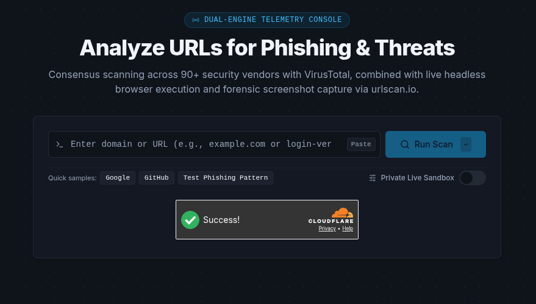

<div align="center">

# PhishGuard — Phishing URL Scanner

An advanced cybersecurity URL inspection and threat intelligence console. Combines consensus scanning across 90+ security vendors with live headless browser sandboxing, forensic screenshot capture, and deep network telemetry.

[](https://urlchecker.debasisbiswas.in)
[](LICENSE)

<br />



</div>

---

## Overview

**PhishGuard** is designed for security analysts, incident responders, and developers to safely investigate untrusted links and phishing campaigns without exposing their local network or browser environment. 

By querying real-time threat intelligence databases and dispatching isolated headless browser sandboxes, PhishGuard provides actionable forensic verdicts within seconds.

---

## Key Capabilities

### 1. Dual-Engine Threat Consensus
* **Multi-Vendor Scanning:** Aggregates real-time detection signatures across 90+ antivirus and anti-phishing engines (powered by [VirusTotal API v3](https://docs.virustotal.com/docs/api-overview)).
* **Filterable Signatures:** Quickly search and filter through vendor consensus (Threats Detected vs. Clean Engines).

### 2. Live Browser Sandboxing & Forensic Previews
* **Isolated Page Execution:** Dispatches target URLs to an isolated headless Chromium sandbox via [urlscan.io](https://urlscan.io/).
* **Visual Viewport Render:** Renders live, high-resolution screenshots in a simulated secure browser viewport with zoom and refresh capabilities.
* **Privacy Toggle:** Supports toggling between Public and Private live sandboxes to prevent sensitive internal links from being indexed in public threat feeds.

### 3. WHOIS & RDAP Domain Forensics
* **Registration Intelligence:** Pulls authoritative ICANN RDAP data including Registrar, Registrant Organization, Country, and registration/expiration timelines.
* **DNS & Infrastructure:** Identifies authoritative Nameservers, current DNS A-records, hosting ASNs, and registry statuses.

### 4. Network Telemetry & Fingerprinting
* **HTTP Transaction Log:** Logs every outbound request dispatched by the target, including HTTP methods, status codes (`200`, `302`, `404`), and MIME types.
* **Technology Fingerprinting:** Detects underlying CMS, web frameworks, analytics platforms, and server headers using Wappalyzer heuristics.
* **Extracted IOCs:** Surfaces all contacted domains and destination IP addresses for rapid security incident intake.

### 5. Defensive Analyst Tools
* **Defanged URL Generation:** One-click copy for defanged URLs (`hxxps://target[.]com`) to safely post indicators of compromise into ticketing systems (Jira, ServiceNow) without accidental click risks.
* **Command Bar Ergonomics:** Monospace input console with quick-paste support, instant sample presets, and keyboard shortcuts (`/` to focus, `Enter` to run).

---

## Security & Architecture

| Component | Provider / Standard | Purpose |
| :--- | :--- | :--- |
| **Threat Intelligence** | VirusTotal Public API v3 | Multi-engine antivirus & phishing consensus |
| **Live Sandboxing** | urlscan.io Engine | Headless DOM execution, network traffic capture & screenshots |
| **Domain Forensics** | ICANN RDAP Resolver | Domain age, registrar validity, and authoritative nameservers |
| **Bot Mitigation** | Cloudflare Turnstile | Protects endpoints from automated abuse without annoying CAPTCHAs |
| **Frontend Platform** | Next.js, React, Tailwind CSS | High-contrast, responsive cybersecurity console with dark/light themes |

---

## Project Structure

```text
├── app/
│   ├── api/
│   │   ├── scan/combined/     # Combined dual-engine orchestration
│   │   ├── urlscan/           # urlscan.io submit, result polling, screenshot proxy
│   │   └── security-policy/   # Security headers and policy endpoints
│   ├── privacy-policy/        # Data handling & compliance details
│   ├── globals.css            # Cyber grid, semantic threat indicators, design tokens
│   ├── layout.tsx             # Root document shell & metadata
│   └── page.tsx               # Main security scanner console
├── components/
│   └── ui/                    # Reusable shadcn/radix primitives (cards, tabs, dialogs)
├── lib/                       # Utility helpers & class merger
└── public/                    # Static assets & icons
```

---

## License

Distributed under the MIT License. See [LICENSE](LICENSE) for full details.

<br />

<div align="center">

<a href="https://www.buymeacoffee.com/debasisbiswas" target="_blank">
  
</a>

<br /><br />

Designed and engineered by **Debasis Biswas** • [contact@debasisbiswas.in](mailto:contact@debasisbiswas.in)

</div>
